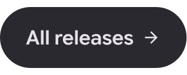
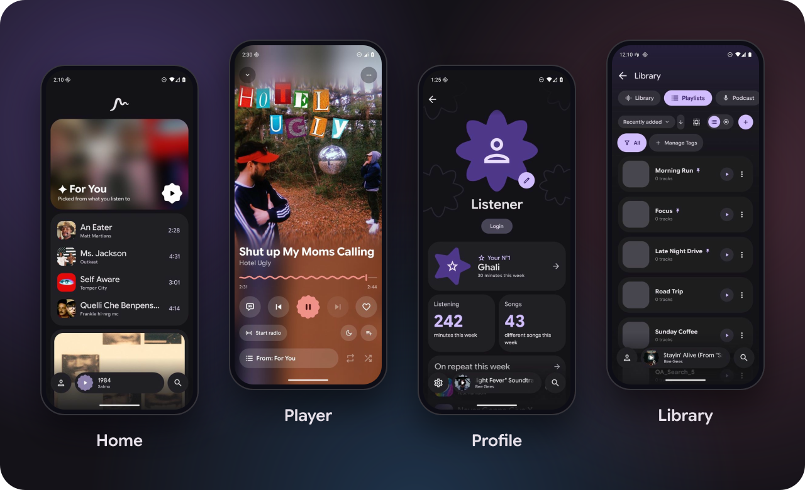
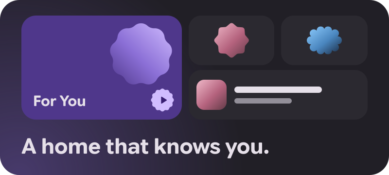
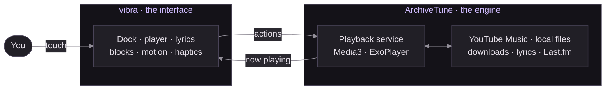

<p align="center">
  
</p>

<p align="center">
  <a href="https://github.com/progettarsi/vibra-music/releases/latest"></a>&emsp;<a href="https://github.com/progettarsi/vibra-music/releases"></a>
</p>

<p align="center">
  <a href="https://github.com/progettarsi/vibra-music/releases/latest"></a>
  
  
  
  <a href="LICENSE"></a>
</p>

<p align="center">
  <b>Every screen flows. Every touch answers. Every cover sets the colour.</b><br>
  vibra is a free, open-source music player for Android: YouTube Music streaming and your own local files,<br>
  in a fluid Material 3 Expressive interface.
</p>

<p align="center">
  <a href="#take-a-look">Screens</a> · <a href="#highlights">Highlights</a> · <a href="#get-vibra">Download</a> · <a href="#build-it-yourself">Build</a> · <a href="#licence-and-credits">Credits</a>
</p>

<picture>
  <source media="(prefers-color-scheme: dark)" srcset=".github/readme/track-1-dark.svg">
  
</picture>

## Take a look



<picture>
  <source media="(prefers-color-scheme: dark)" srcset=".github/readme/track-2-dark.svg">
  
</picture>

## Feel comes first

vibra is designed around a single question: how does it feel? Every screen, every transition and every touch is tuned until the answer is right. Nothing ships until it moves as well as everything around it, which is why vibra does fewer things, and each of them beautifully.

<table>
<tr>
<td width="33%" valign="top">
<br>
<b>Everything moves on springs.</b><br>
Grab any animation, throw it, stop it halfway. It follows your finger, never a timer.
</td>
<td width="33%" valign="top">
<br>
<b>Nothing ever blinks.</b><br>
Pages grow out of whatever you tapped, and fold back into it.
</td>
<td width="33%" valign="top">
<br>
<b>Every tap is felt.</b><br>
Buttons squash, bounce and answer with a soft buzz under your thumb.
</td>
</tr>
</table>

<picture>
  <source media="(prefers-color-scheme: dark)" srcset=".github/readme/track-3-dark.svg">
  
</picture>

## Highlights

<table>
<tr>
<td width="50%" valign="top">



- Profile, mini-player and search share one floating dock. Search grows straight out of its own button.
- The now playing screen rises out of the mini-player and sinks back into it, right under your finger.
- Swipe the mini-player sideways and it melts into its neighbour on the way to the next song.
- Every page opens from what you tapped, and predictive back follows your thumb.

</td>
<td width="50%" valign="top">



- The album art fills the screen and spills its colours into everything behind it.
- Canvas loops and music videos take its place, perfectly in sync.
- Swipe the cover to skip. The seek bar ripples while the music plays.
- Even the sleep timer dresses in the song's colours.

</td>
</tr>
<tr>
<td width="50%" valign="top">



- Synced lyrics light up word by word, karaoke-style, right on the beat.
- Scroll away and they glide back to the line being sung.
- One calm design, set in the same type as the rest of the app.

</td>
<td width="50%" valign="top">



- Home, library and profile are built from blocks, each sized by how much it matters to you.
- For You mixes what you love, online or offline. When suggestions run dry, forgotten favourites come back around.
- Pin your playlists, reorder them with a long press, clear out several at once.
- Listening stats show what you've had on repeat.

</td>
</tr>
<tr>
<td width="50%" valign="top">



- Energy is spiky. Calm is soft. Love is a heart.
- Give every playlist one of 12 cover shapes, or a picture of your own.
- Pick your profile's shape and a main colour, and the whole app re-themes itself, Material You style.

</td>
<td width="50%" valign="top">



- YouTube Music streaming, search and library, with or without an account.
- Import your artists, liked songs and playlists from Spotify.
- Local files, offline downloads that pick up where they left off, lyrics from several sources.
- Equalizer, loudness normalization, crossfade, Google Cast and Last.fm scrobbling.

</td>
</tr>
</table>

<picture>
  <source media="(prefers-color-scheme: dark)" srcset=".github/readme/track-4-dark.svg">
  
</picture>

## Get vibra

1. Download the APK from the [latest release](https://github.com/progettarsi/vibra-music/releases/latest). It runs on Android 8.0 and newer.
2. Open it on your phone and allow installs from that source when Android asks.
3. That's it. vibra looks for updates every time you open it, and each one installs right over the last.

> [!NOTE]
> Play Protect may offer to scan vibra before installing. That's normal for a new app Google hasn't met yet.

<picture>
  <source media="(prefers-color-scheme: dark)" srcset=".github/readme/track-5-dark.svg">
  
</picture>

## Build it yourself

vibra is written in Kotlin with Jetpack Compose. All it takes to build it is JDK 21 and the Android SDK (platform 37).

```bash
./gradlew :app:assembleGmsMobileUniversalDebug
adb install -r app/build/outputs/apk/gmsMobileUniversal/debug/app-gms-mobile-universal-debug.apk
```

The debug build installs as **vibra debug**, right next to the release. [`docs/SETUP.md`](docs/SETUP.md) covers build variants, release signing and the optional integrations.

<picture>
  <source media="(prefers-color-scheme: dark)" srcset=".github/readme/track-6-dark.svg">
  
</picture>

## How it fits together

vibra is a YouTube Music client that stands on the shoulders of [ArchiveTune](https://github.com/rukamori/ArchiveTune). Its engine, with Media3 and ExoPlayer for playback, does the heavy lifting underneath. Everything you see and touch on top is new: designed in Figma on Material 3 Expressive, built in Jetpack Compose.



| Where | What |
|---|---|
| `app/src/main/kotlin/app/vibra/` | vibra's interface: shell and dock, player, lyrics, blocks, motion, haptics, theme |
| `app/src/main/kotlin/moe/rukamori/archivetune/` | The music engine: playback service, database, YouTube Music, settings |
| `core/`, `lyrics/`, `lastfm/`, `morideobfuscator/`, … | Engine libraries |

[`docs/ARCHITECTURE.md`](docs/ARCHITECTURE.md) explains how the pieces fit, and [`docs/FIGMA_IMPLEMENTATION_MAP.md`](docs/FIGMA_IMPLEMENTATION_MAP.md) maps the design to the code.

<picture>
  <source media="(prefers-color-scheme: dark)" srcset=".github/readme/track-7-dark.svg">
  
</picture>

## Licence and credits

vibra is free software under the **GNU General Public License v3.0** (see [`LICENSE`](LICENSE)). It contains code © Rukamori and the ArchiveTune contributors. Their copyright notices are kept in every engine file, and their original documents are in [`docs/upstream/`](docs/upstream). The bundled fonts (Roboto, Google Sans Flex) are under the SIL Open Font License 1.1. Third-party licences are listed in the app under *Settings → About*.

vibra is not affiliated with or endorsed by ArchiveTune, YouTube, Spotify or Google. Please don't send vibra's changes to the ArchiveTune repositories.

### Disclaimer

vibra is vibecoded, with the help of Claude Code and Codex.

That doesn't make it a weekend experiment waiting to be abandoned. vibra is the music app I use every day, the one I built because it's the one I wanted on my own phone. So I'm always the first to notice when something is off, and the first to fix it. It will keep getting better for as long as I keep listening.

<p align="center">
  
</p>
